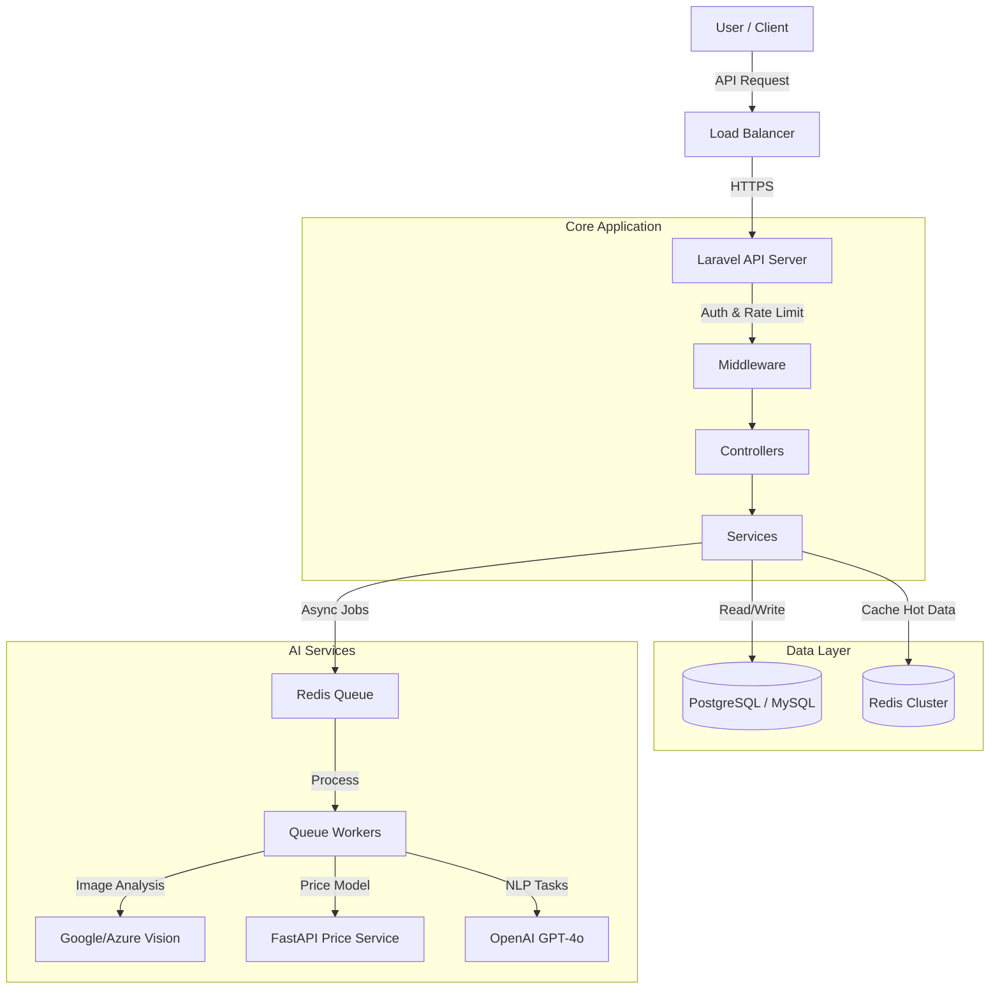

# AI System Architecture & Implementation Guide

This document outlines the architecture, design decisions, and scaling strategies for the AI-powered Real Estate Platform.

## 1. System Overview

The system is designed as a modular monolith with clear service boundaries for AI components. It leverages **Laravel** for the core application logic, **Python/FastAPI** for specialized ML tasks (price prediction), and **Redis** for high-performance caching.

### Key Components

1.  **Smart Search (NLP)**: GPT-4o powered natural language to SQL filter conversion.
2.  **Hybrid Recommendations**: Weighted scoring engine (Price/Location/Behavior) with pre-computed scores.
3.  **Price Prediction**: Microservice architecture with fallback to AI API.
4.  **AI Chatbot**: Context-aware advisor with session memory and hallucination guardrails.
5.  **Image Analysis**: Async processing pipeline using Vision APIs.

---

## 2. Architecture Diagram & Data Flow



## 3. Directory Structure

The AI system is isolated within the `app/Services/AI` namespace to maintain separation of concerns.

```text
app/
├── Http/
│   ├── Controllers/
│   │   └── AI/
│   │       ├── SmartSearchController.php
│   │       ├── RecommendationController.php
│   │       ├── PricePredictionController.php
│   │       ├── ChatbotController.php
│   │       └── ImageAnalysisController.php
│   └── Middleware/
│       ├── AiRateLimitMiddleware.php
│       └── AdminMiddleware.php
├── Services/
│   └── AI/
│       ├── SmartSearchService.php      # NLP -> Filters
│       ├── RecommendationService.php   # Hybrid Scoring Engine
│       ├── PricePredictionService.php  # Microservice Integration
│       ├── ChatbotService.php          # RAG & Context Management
│       ├── ImageAnalysisService.php    # Vision API Wrapper
│       └── Concerns/
│           ├── CallsOpenAI.php         # Shared API Logic
│           ├── LogsAiUsage.php         # Cost Tracking
│           └── SanitizesPrompt.php     # Security
├── Jobs/
│   └── AI/
│       ├── AnalyzePropertyImageJob.php
│       └── RecalculatePropertyScoresJob.php
└── Console/
    └── Commands/
        └── RecalcScoresCommand.php
```

## 4. Scalability & Performance

### 4.1 Caching Strategy (Redis)
*   **Recommendation Scores**: Computed hourly via background jobs and cached (`recs_user_{id}`).
*   **User Profiles**: Aggregated behavior data (views, saves) is cached to avoid expensive joins on every request.
*   **Smart Search**: Parsed NLP queries are cached by hash of input text (`ai_search_{hash}`) for 15 minutes.

### 4.2 Database Indexing
To support 100k+ properties and high traffic, the following indexes are critical:

*   **Properties Table**:
    *   `status` + `listing_type` (Base filtering)
    *   `city` + `district` (Location search)
    *   `price` (Range queries)
*   **AI Logs**:
    *   `feature` + `created_at` (For analytics dashboards)
*   **Price History**:
    *   `property_id` + `date` (For trend analysis)

### 4.3 Queue System
*   **Image Analysis**: Heavy vision API calls are strictly backgrounded.
*   **Score Recalculation**: Scheduled hourly batches to prevent database locking.

## 5. Security & Cost Control

### 5.1 Prompt Injection Prevention
*   **Sanitization**: All user inputs pass through `SanitizesPrompt` trait.
*   **Pattern Matching**: Blocks inputs containing "system instruction", "ignore previous", etc.
*   **Token Limits**: Strict `max_tokens` settings on all API calls.

### 5.2 Rate Limiting (Throttle)
Granular limits applied in `routes/api.php`:
*   **Search**: 20 requests/minute (Prevent scraping)
*   **Chat**: 10 requests/minute (Cost control)
*   **Analysis**: 100 requests/hour (Heavy API usage)

### 5.3 Cost Tracking
Every AI interaction is logged to `ai_usage_logs` with:
*   Input/Output token counts
*   Estimated USD cost
*   Model used
*   Initiating user

## 6. Microservice Integration (Price Prediction)

The system supports a Python/FastAPI microservice for advanced regression models.

*   **Primary**: Call internal Python API (Scikit-learn model).
*   **Fallback**: If Microservice fails/timeouts, seamlessly degrade to GPT-4o estimation.
*   **Data Contract**: JSON payload containing `area`, `location_id`, `features`.

## 7. Deployment Checklist

1.  **Environment Variables**:
    *   `OPENAI_API_KEY`
    *   `GOOGLE_APPLICATION_CREDENTIALS`
    *   `PRICE_SERVICE_URL`
2.  **Workers**: Start `php artisan queue:work --queue=default,image-analysis`.
3.  **Scheduler**: Ensure `php artisan schedule:run` is active for hourly recommendations.
4.  **Migrations**: Run `php artisan migrate`.

